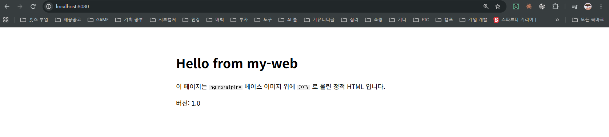
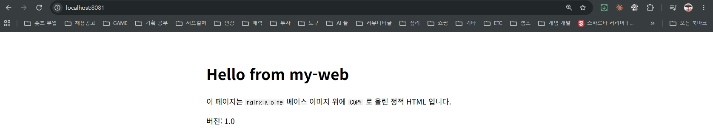
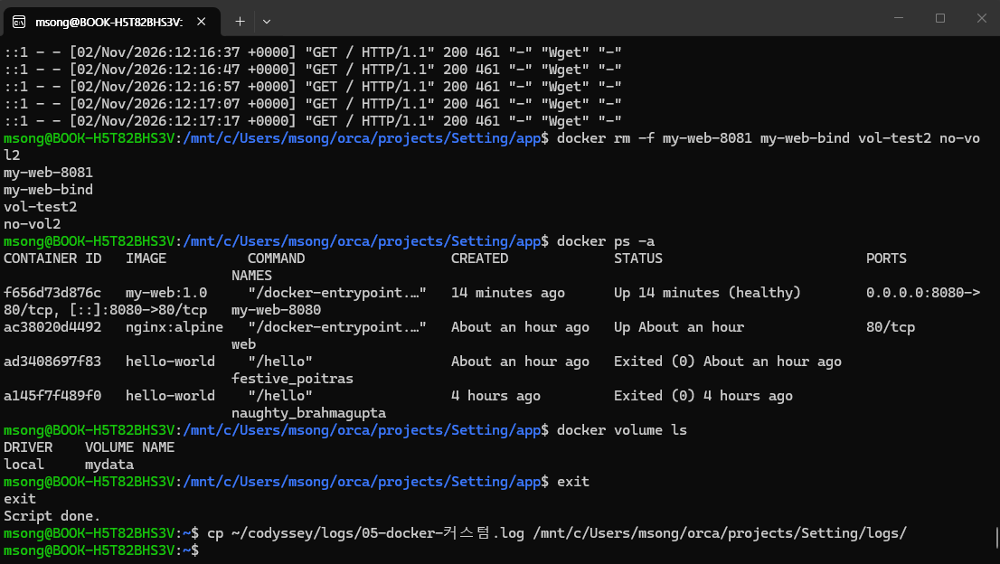
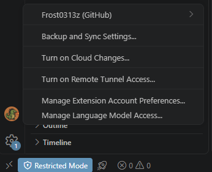
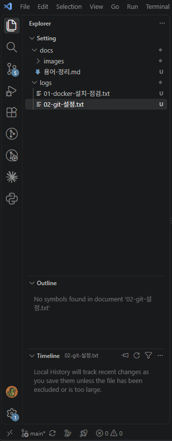
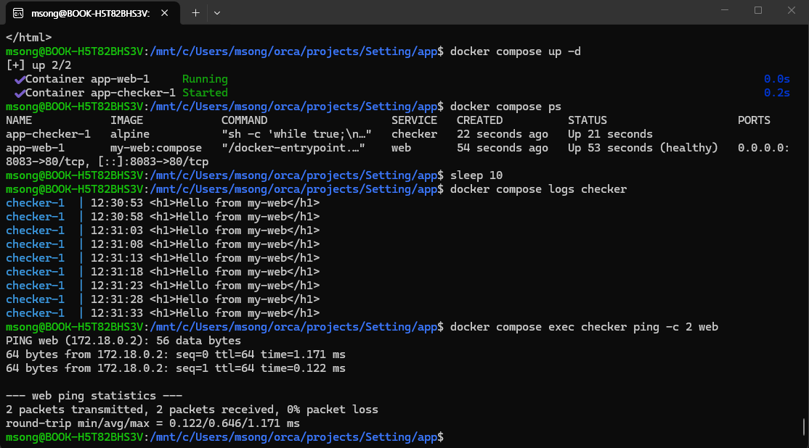
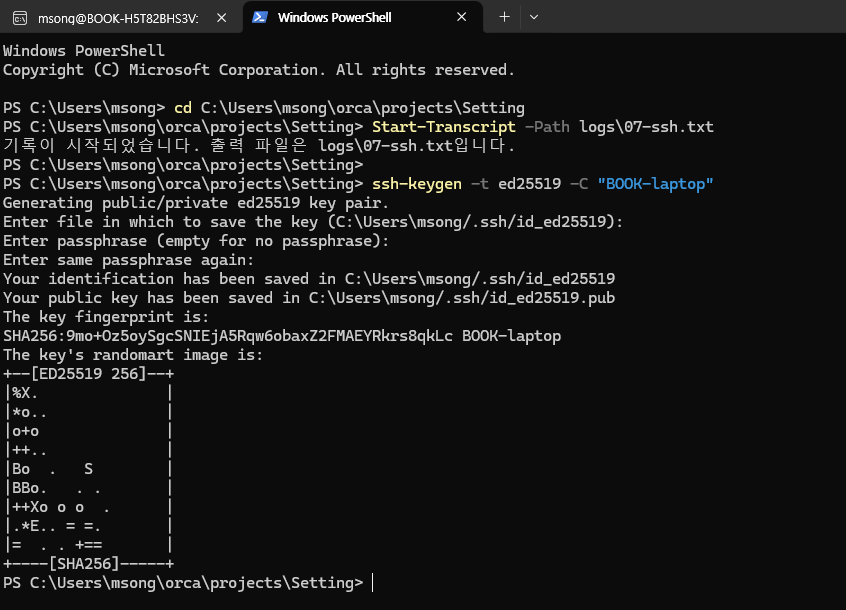
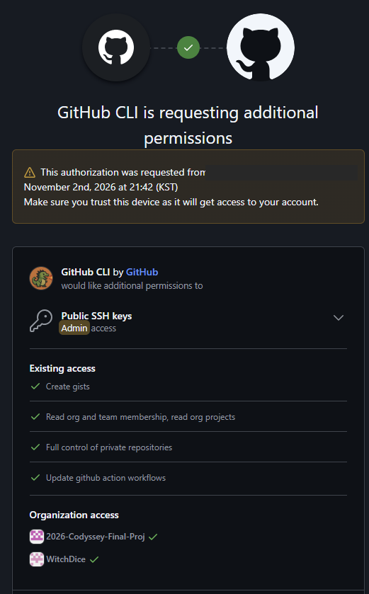
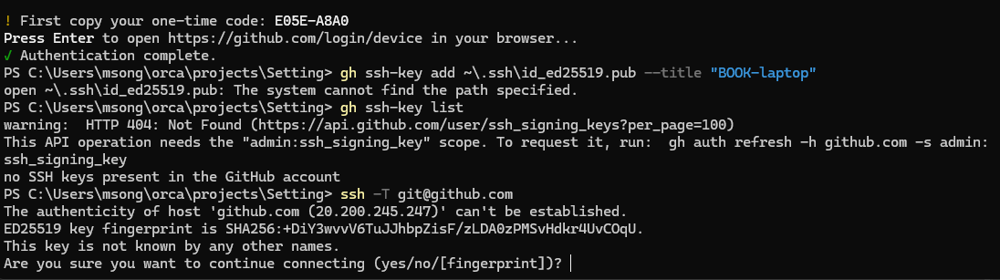
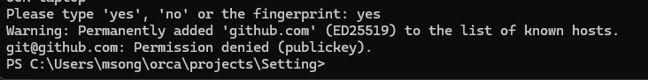

# 개발 워크스테이션 구축 미션

터미널 · 파일 권한 · Docker · Dockerfile · 포트 매핑 · 바인드 마운트 · 볼륨 · Git/GitHub 를
직접 세팅하고, 명령과 출력 결과를 증거로 남긴 기록이다. 수행일 2026-11-02.

이 문서만 읽어도 전체 수행 내용을 파악할 수 있도록 썼다. 전체 로그와 캡처는 `logs/`, `docs/images/` 에 있고 본문에서 링크한다.

---

## 1. 프로젝트 개요

**미션 목표**: 코드가 "내 컴퓨터에서만" 돌아가는 문제를 줄이고, 누구나 같은 방식으로 실행·배포·디버깅할 수 있는 환경을 만든다. 핵심 도구 세 가지를 직접 손으로 세팅한다.

| 도구 | 역할 | 이 저장소에서 한 일 |
|---|---|---|
| 리눅스 CLI | 작업 디렉토리와 권한 정리 | 기본 명령 9종, 파일·디렉토리 권한 변경 실험 |
| Docker | 재현 가능한 실행 환경 | 설치 점검, 운영 명령, 커스텀 이미지, 포트, 마운트, 볼륨 |
| Git / GitHub | 버전 관리와 협업 | 사용자·기본 브랜치 설정, 저장소 연동, VSCode 로그인 |

---

## 2. 실행 환경

2026-11-02 측정.

| 항목 | 값 |
|---|---|
| 호스트 OS | Windows 11 Home 10.0.26200 |
| 리눅스 환경 | WSL 2 (3.0.3), Ubuntu 24.04.5 LTS, 커널 6.18.54.1-microsoft-standard-WSL2 |
| 쉘 / 터미널 | bash / Windows Terminal |
| Docker | Docker Desktop 4.97.0, Engine 29.9.2 (Client · Server 동일) |
| Git | 2.56.0.windows.4 |
| GitHub CLI | 2.97.0 |
| 편집기 | VSCode 1.143 |

**주의 (재현성)**: 미션 예시는 Ubuntu 네이티브 기준이다. 이 노트북은 Windows 라서 **터미널·권한 실습은 WSL Ubuntu 안에서**, Docker 는 **Docker Desktop (WSL 2 백엔드)** 으로 수행했다. 저장소 경로 `/mnt/c/Users/msong/...` 는 이 PC 고유이므로, 다른 PC 에서 따라 할 때는 저장소를 clone 한 경로로 바꾸면 된다. 서울캠퍼스의 OrbStack 은 macOS 전용이라 해당 없음.

---

## 3. 수행 체크리스트

- [x] 터미널 기본 조작 (pwd, ls -la, cd, mkdir, touch, cp, mv, rm, cat) → [4절](#4-터미널-조작-로그)
- [x] 파일 1개 + 디렉토리 1개 권한 변경 전/후 비교 → [5절](#5-권한-실습)
- [x] Docker 설치 · 데몬 점검 (`docker --version`, `docker info`) → [6절](#6-docker-설치-점검)
- [x] Docker 운영 명령 (images, ps, ps -a, logs, stats) → [7절](#7-docker-기본-운영-명령)
- [x] hello-world 실행, ubuntu 컨테이너 진입, attach / exec 차이 관찰 → [8절](#8-컨테이너-실행-실습)
- [x] Dockerfile 직접 작성 → 커스텀 이미지 빌드 · 실행 → [9절](#9-dockerfile-기반-커스텀-이미지)
- [x] 포트 매핑 2회 + 브라우저 접속 캡처 → [10절](#10-포트-매핑-접속-증거)
- [x] 바인드 마운트: 호스트 변경 전/후 → [11절](#11-바인드-마운트-반영)
- [x] Docker 볼륨: 컨테이너 삭제 전/후 → [12절](#12-볼륨-영속성)
- [x] Git 사용자 · 기본 브랜치 설정, `git config --list` → [13절](#13-git-설정-및-github--vscode-연동)
- [x] GitHub 저장소 연동 + VSCode 로그인 캡처 → [13절](#13-git-설정-및-github--vscode-연동)
- [x] 트러블슈팅 2건 이상 (7건) → [14절](#14-트러블슈팅)
- [x] 민감정보 마스킹 → [16절](#16-보안-및-개인정보)
- [x] 보너스: Docker Compose 단일/멀티/운영 명령, 환경 변수 → [17절](#17-보너스-과제)
- [x] 보너스: GitHub SSH 키 생성 · 등록 · SSH 푸시 → [17-5절](#17-5-github-ssh-키)

---

## 증거 파일 목록

| 파일 | 내용 | 방법 |
|---|---|---|
| [logs/01-docker-설치-점검.txt](logs/01-docker-설치-점검.txt) | `docker --version`, `docker info`, hello-world | PowerShell 출력 저장 |
| [logs/02-git-설정.txt](logs/02-git-설정.txt) | `git --version`, `git config --list`, remote, 저장소 정보 | PowerShell 출력 저장 |
| [logs/03-터미널-실습.log](logs/03-터미널-실습.log) | 터미널 기본 조작 + 권한 실습 전체 | `script` 명령으로 세션 녹화 |
| [logs/04-docker-실습.log](logs/04-docker-실습.log) | Docker 운영 명령, ubuntu 진입, attach/exec | `script` 녹화 |
| [logs/05-docker-커스텀.log](logs/05-docker-커스텀.log) | 빌드, 포트 매핑, 바인드 마운트, 볼륨 | `script` 녹화 |
| [docs/images/포트-8080.png](docs/images/포트-8080.png) | 브라우저 `localhost:8080` | 캡처 |
| [docs/images/포트-8081.png](docs/images/포트-8081.png) | 브라우저 `localhost:8081` | 캡처 |
| [docs/images/vscode-github-로그인.png](docs/images/vscode-github-로그인.png) | VSCode 계정 메뉴의 GitHub 로그인 | 캡처 |
| [docs/images/vscode-원격-연동.png](docs/images/vscode-원격-연동.png) | VSCode 상태 표시줄 `main` + 동기화 아이콘 | 캡처 |
| [docs/images/터미널-볼륨-정리.png](docs/images/터미널-볼륨-정리.png) | 컨테이너 삭제 후 볼륨이 남아 있는 터미널 화면 | 캡처 |
| [logs/06-compose.log](logs/06-compose.log) | 보너스: Compose 단일/멀티, 운영 명령, 환경 변수 | `script` 녹화 |
| [docs/images/compose-서비스-디스커버리.png](docs/images/compose-서비스-디스커버리.png) | checker 가 `web` 이름으로 접속하는 로그와 ping | 캡처 |
| [app/docker-compose.yml](app/docker-compose.yml) | 보너스: Compose 파일 | |
| [logs/07-ssh.txt](logs/07-ssh.txt) | 보너스: SSH 키 생성 · 등록 · 접속 확인 | PowerShell `Start-Transcript` |
| [docs/images/ssh-키-생성.png](docs/images/ssh-키-생성.png) | `ssh-keygen` 결과 | 캡처 |
| [docs/images/github-ssh-권한-승인.png](docs/images/github-ssh-권한-승인.png) | GitHub CLI 권한 승인 화면 (IP 마스킹) | 캡처 |
| [docs/images/ssh-등록-전.png](docs/images/ssh-등록-전.png) | 공개키 등록 실패(`~` 경로)와 첫 `ssh -T` 시도 | 캡처 |
| [docs/images/ssh-등록-전-denied.png](docs/images/ssh-등록-전-denied.png) | 등록 전 `Permission denied (publickey)` | 캡처 |
| [app/Dockerfile](app/Dockerfile) | 직접 작성한 Dockerfile | |
| [app/site/index.html](app/site/index.html) | 컨테이너가 내보내는 정적 페이지 | |

`script` 로 녹화한 로그는 터미널 제어 코드를 제거한 정리본이다. 백스페이스로 오타를 고친 흔적이 몇 줄 남아 있는데(예: `ru n.sh`), 실제 실행된 명령은 바로 아래 출력이 증명한다. 손으로 고치지 않았다.

---

## 4. 터미널 조작 로그

WSL Ubuntu, `~/codyssey/practice` 에서 수행. 전체: [logs/03-터미널-실습.log](logs/03-터미널-실습.log)

```bash
msong@BOOK-H5T82BHS3V:~/codyssey/practice$ pwd
/home/msong/codyssey/practice
msong@BOOK-H5T82BHS3V:~/codyssey/practice$ ls -la
total 16
drwxr-xr-x 2 msong msong 4096 Nov  2 17:48 .
drwxr-xr-x 4 msong msong 4096 Nov  2 18:56 ..
-rw-r--r-- 1 msong msong    6 Nov  2 17:48 hello.txt
-rw-r--r-- 1 msong msong    0 Nov  2 17:47 memo.txt
msong@BOOK-H5T82BHS3V:~/codyssey/practice$ mkdir -p ~/codyssey/practice
msong@BOOK-H5T82BHS3V:~/codyssey/practice$ touch memo.txt
msong@BOOK-H5T82BHS3V:~/codyssey/practice$ cat hello.txt
heelo linux
msong@BOOK-H5T82BHS3V:~/codyssey/practice$ cat memo.txt
msong@BOOK-H5T82BHS3V:~/codyssey/practice$ cp hello.txt renamed.txt
msong@BOOK-H5T82BHS3V:~/codyssey/practice$ mkdir sub
msong@BOOK-H5T82BHS3V:~/codyssey/practice$ mv renamed.txt sub/
msong@BOOK-H5T82BHS3V:~/codyssey/practice$ rm sub/renamed.txt
msong@BOOK-H5T82BHS3V:~/codyssey/practice$ rm -r sub
msong@BOOK-H5T82BHS3V:~/codyssey/practice$ ls -la
total 16
drwxr-xr-x 2 msong msong 4096 Nov  2 19:00 .
drwxr-xr-x 4 msong msong 4096 Nov  2 18:56 ..
-rw-r--r-- 1 msong msong   12 Nov  2 18:58 hello.txt
-rw-r--r-- 1 msong msong    0 Nov  2 18:58 memo.txt
```

| 요구 항목 | 명령 |
|---|---|
| 현재 위치 확인 | `pwd` |
| 목록 확인 (숨김 포함) | `ls -la` (`.`, `..` 가 보임) |
| 이동 | `cd ~/codyssey/practice`, `cd /tmp` |
| 생성 | `mkdir -p`, `mkdir sub` |
| 복사 | `cp hello.txt renamed.txt` |
| 이동 / 이름변경 | `mv renamed.txt sub/` |
| 삭제 | `rm`, `rm -r sub` |
| 파일 내용 확인 | `cat hello.txt` |
| 빈 파일 생성 | `touch memo.txt` (cat 하면 빈 출력) |

### 절대 경로 vs 상대 경로 실험

```bash
msong@BOOK-H5T82BHS3V:~/codyssey/practice$ cat ./hello.txt
heelo linux
msong@BOOK-H5T82BHS3V:~/codyssey/practice$ cd /tmp
msong@BOOK-H5T82BHS3V:/tmp$ cat ./hello.txt
cat: ./hello.txt: No such file or directory
msong@BOOK-H5T82BHS3V:/tmp$ cat /home/msong/codyssey/practice/hello.txt
heelo linux
```

같은 `./hello.txt` 가 현재 위치에 따라 성공·실패한다. 절대 경로는 어디서 쳐도 같은 파일을 가리킨다.

---

## 5. 권한 실습

전체: [logs/03-터미널-실습.log](logs/03-터미널-실습.log)

### 파일 (run.sh): 644 → 755 → 644

```bash
$ echo 'echo "script ran"' > run.sh
$ ls -l run.sh
-rw-r--r-- 1 msong msong 18 Nov  2 19:07 run.sh        # 변경 전 644: 실행 권한 없음
$ ./run.sh
bash: ./run.sh: Permission denied

$ chmod 755 run.sh
$ ls -l run.sh
-rwxr-xr-x 1 msong msong 18 Nov  2 19:07 run.sh        # 변경 후 755
$ ./run.sh
script ran

$ chmod 644 run.sh
$ ./run.sh
bash: ./run.sh: Permission denied                     # 되돌리면 다시 거부
```

### 디렉토리 (secret): 755 → 000 → 755

```bash
$ mkdir secret && echo "inside" > secret/note.txt
$ ls -ld secret
drwxr-xr-x 2 msong msong 4096 Nov  2 19:09 secret      # 변경 전 755

$ chmod 000 secret
$ ls -ld secret
d--------- 2 msong msong 4096 Nov  2 19:09 secret      # 변경 후 000
$ ls secret
ls: cannot open directory 'secret': Permission denied   # r 없음 → 목록 불가
$ cat secret/note.txt
cat: secret/note.txt: Permission denied                # x 없음 → 안으로 진입 불가

$ chmod 755 secret
$ cat secret/note.txt
inside
```

`note.txt` 자체는 644 그대로였다. 디렉토리의 x 가 없으면 안의 파일이 읽기 가능해도 닿을 수 없다.

### 글자 방식

```bash
$ chmod +x run.sh  && ls -l run.sh      # -rwxr-xr-x
$ chmod o-r run.sh && ls -l run.sh      # -rwxr-x--x  (기타에서 r 제거)
```

### 권한 표기 해석

r=4, w=2, x=1 을 더해 소유자·그룹·기타 순으로 세 자리.

| 표기 | 소유자 | 그룹 | 기타 | 용도 |
|---|---|---|---|---|
| 755 | rwx | r-x | r-x | 실행 파일, 디렉토리 |
| 644 | rw- | r-- | r-- | 일반 문서 |

파일의 x 는 "실행할 수 있다", 디렉토리의 x 는 "안으로 들어갈 수 있다".

---

## 6. Docker 설치 점검

전체: [logs/01-docker-설치-점검.txt](logs/01-docker-설치-점검.txt)

```
$ docker --version
Docker version 29.9.2, build a82e528

$ docker info
Client:
 Version:    29.9.2
 Context:    desktop-linux
 ...
Server:
 Server Version: 29.9.2
 Operating System: Docker Desktop
 OSType: linux
 Architecture: x86_64
 Total Memory: 7.551GiB
```

`docker info` 에 Server 블록이 나오면 데몬이 동작 중이다. `docker` 명령은 클라이언트이고, 실제 작업은 백그라운드의 데몬(`dockerd`)이 한다. 데몬이 꺼져 있으면 `Cannot connect to the Docker daemon` 이 난다.

```
$ docker run hello-world
Hello from Docker!
This message shows that your installation appears to be working correctly.
```

---

## 7. Docker 기본 운영 명령

전체: [logs/04-docker-실습.log](logs/04-docker-실습.log), [logs/05-docker-커스텀.log](logs/05-docker-커스텀.log)

```
$ docker pull ubuntu
$ docker pull nginx:alpine
$ docker images
IMAGE                ID             DISK USAGE   CONTENT SIZE
hello-world:latest   c567b231f656       25.9kB         9.49kB
my-web:1.0           443bc7876d62       93.6MB         26.3MB
nginx:alpine         785835ea65db       94.5MB         27.2MB
ubuntu:latest        6a06111c3b0a        163MB         45.9MB
```

```
$ docker run hello-world
$ docker ps                       # 비어 있음: hello-world 는 출력 후 바로 종료됨
$ docker ps -a
CONTAINER ID   IMAGE         COMMAND    CREATED          STATUS                      NAMES
ad3408697f83   hello-world   "/hello"   17 seconds ago   Exited (0) 16 seconds ago   festive_poitras

$ docker run -d --name web nginx:alpine
$ docker stop web  && docker ps -a   # Exited
$ docker start web && docker ps      # Up
```

```
$ docker stats --no-stream
CONTAINER ID   NAME      CPU %     MEM USAGE / LIMIT     MEM %     NET I/O         BLOCK I/O    PIDS
ac38020d4492   web       0.00%     16.58MiB / 7.551GiB   0.21%     1.17kB / 126B   0B / 4.1kB   19

$ docker exec web wget -qO- http://localhost     # 컨테이너 안에서 자기 웹 서버 호출
$ docker logs web
::1 - - [02/Nov/2026:11:33:48 +0000] "GET / HTTP/1.1" 200 896 "-" "Wget" "-"
```

컨테이너는 메인 프로세스가 끝나면 함께 끝난다. hello-world 는 메시지 출력이 끝나 `Exited`, nginx 는 계속 대기하므로 `Up`.

---

## 8. 컨테이너 실행 실습

### ubuntu 컨테이너 진입 (exec)

```
$ docker run -d --name u1 ubuntu sleep infinity
$ docker exec -it u1 bash
root@c3111606d18f:/# ls /
bin  boot  dev  etc  home  lib  lib64  media  mnt  opt  proc  root  run  sbin  srv  sys  tmp  usr  var
root@c3111606d18f:/# echo "inside container"
inside container
root@c3111606d18f:/# whoami
root
root@c3111606d18f:/# hostname
c3111606d18f
root@c3111606d18f:/# touch /tmp/mark.txt
root@c3111606d18f:/# docker exec web wget -qO- http://localhost
bash: docker: command not found          # 컨테이너 안에는 docker 가 없다 (격리)
root@c3111606d18f:/# exit
$ docker ps                              # u1 여전히 Up
$ docker exec u1 ls /tmp
mark.txt                                 # 안에서 만든 파일이 남아 있음
```

### attach 와 비교

```
$ docker run -dit --name u2 ubuntu bash
$ docker attach u2
root@c063857f3d51:/# echo "attached"
attached
root@c063857f3d51:/# exit
$ docker ps                              # u2 없음
$ docker ps -a
c063857f3d51   ubuntu   "bash"   ...   Exited (0) 15 seconds ago   u2
```

### 관찰 정리

| | exec | attach |
|---|---|---|
| 연결 대상 | 새 프로세스를 하나 더 띄움 | 이미 도는 메인 프로세스(PID 1)에 붙음 |
| `exit` 하면 | 새 프로세스만 끝나고 컨테이너 유지 | 메인 프로세스가 끝나 컨테이너 종료 |
| 실무 | 들어가서 확인하고 나올 때 거의 항상 exec | 메인 프로세스 화면을 직접 봐야 할 때 |

컨테이너 안과 밖을 구분하는 법: 프롬프트가 `root@짧은ID` 이면 안, `msong@BOOK-...` 이면 밖. `whoami` 와 `hostname` 으로도 판별된다 (트러블슈팅 5번).

---

## 9. Dockerfile 기반 커스텀 이미지

**선택한 방식**: (A) 웹 서버 베이스 이미지 + 정적 콘텐츠·설정 교체.
**베이스**: Docker Hub 공식 `nginx:alpine`. 웹 서버가 이미 들어 있고 alpine 리눅스라 작다(94MB).

### Dockerfile ([app/Dockerfile](app/Dockerfile), 직접 작성)

```dockerfile
FROM nginx:alpine
LABEL org.opencontainers.image.title="my-web"
LABEL org.opencontainers.image.authors="Frost0313z"
ENV APP_ENV=dev
COPY site/ /usr/share/nginx/html/
EXPOSE 80
HEALTHCHECK --interval=10s --timeout=3s CMD wget -qO- http://localhost/ || exit 1
```

### 커스텀 포인트와 목적

| 줄 | 커스텀 포인트 | 목적 |
|---|---|---|
| `FROM nginx:alpine` | 베이스 선택 | 웹 서버 구현 없이 콘텐츠만 교체하면 되게 |
| `LABEL ...` | 메타데이터 | `docker inspect` 로 제작자·용도 확인 가능 |
| `ENV APP_ENV=dev` | 환경 변수 | 설정을 코드 밖에 둔다. 실행 시 `-e` 로 덮어쓸 수 있다 |
| `COPY site/ /usr/share/nginx/html/` | 정적 콘텐츠 교체 | nginx 기본 환영 페이지 대신 내 HTML 을 내보낸다 |
| `EXPOSE 80` | 포트 문서화 | "80 번을 쓴다"는 표시. 실제 연결은 `-p` 가 한다 |
| `HEALTHCHECK ...` | 상태 검사 | 10초마다 자기 페이지를 받아 보고 실패하면 unhealthy |

### 빌드 · 실행

```
$ cd /mnt/c/Users/msong/orca/projects/Setting/app
$ docker build -t my-web:1.0 .
 => [internal] load build definition from Dockerfile
 => CACHED [1/2] FROM docker.io/library/nginx:alpine@sha256:785835ea65db...
 => [2/2] COPY site/ /usr/share/nginx/html/
 => exporting to image
 => => naming to docker.io/library/my-web:1.0

$ docker inspect my-web:1.0 --format '{{.Config.Labels}} {{.Config.Env}}'
map[... org.opencontainers.image.authors:Frost0313z org.opencontainers.image.title:my-web] [... APP_ENV=dev]
```

```
$ docker run -d -p 8080:80 --name my-web-8080 my-web:1.0
$ docker ps
CONTAINER ID   IMAGE        STATUS                    PORTS                    NAMES
f656d73d876c   my-web:1.0   Up 37 seconds (healthy)   0.0.0.0:8080->80/tcp     my-web-8080
```

`(healthy)` 는 HEALTHCHECK 가 통과했다는 표시다. `docker logs my-web-8080` 에 10초마다 `"GET / HTTP/1.1" 200 ... "Wget"` 이 찍히는 것이 그 흔적이다.

---

## 10. 포트 매핑 접속 증거

같은 이미지를 호스트 포트만 다르게 두 번 실행했다.

```
$ docker run -d -p 8080:80 --name my-web-8080 my-web:1.0
$ docker run -d -p 8081:80 --name my-web-8081 my-web:1.0
$ docker ps
82963e3ca867   my-web:1.0   Up 4 seconds (health: starting)   0.0.0.0:8081->80/tcp   my-web-8081
f656d73d876c   my-web:1.0   Up 37 seconds (healthy)           0.0.0.0:8080->80/tcp   my-web-8080
ac38020d4492   nginx:alpine Up About an hour                  80/tcp                 web

$ curl http://localhost:8080
  <h1>Hello from my-web</h1>
  <p>버전: 1.0</p>
$ curl http://localhost:8081
  <h1>Hello from my-web</h1>
  <p>버전: 1.0</p>
```

브라우저 접속 (주소창 포함):





`docker logs my-web-8080` 에 브라우저 접속이 기록됐다:

```
172.17.0.1 - - [02/Nov/2026:12:05:33 +0000] "GET / HTTP/1.1" 200 461 "-" "Mozilla/5.0 (Windows NT 10.0; Win64; x64) ..."
172.17.0.1 - - [02/Nov/2026:12:05:34 +0000] "GET /favicon.ico HTTP/1.1" 404 555 ...
```

### 포트 매핑이 필요한 이유

컨테이너는 격리된 네트워크를 쓰므로 안에서 80 번으로 대기해도 호스트에서 직접 닿을 수 없다. 위 `web` 컨테이너(PORTS `80/tcp` 만 표시)가 그 상태다. `-p 호스트:컨테이너` 로 호스트 포트를 컨테이너 포트에 연결해야 `localhost:8080` 으로 접속된다. 호스트 포트를 달리 주면 같은 이미지를 여러 개 동시에 띄울 수 있다.

---

## 11. 바인드 마운트 반영

호스트 폴더 `app/site` 를 컨테이너의 nginx 문서 폴더에 직접 연결했다.

```
$ docker run -d -p 8082:80 --name my-web-bind -v "$PWD/site:/usr/share/nginx/html" nginx:alpine
$ curl -s http://localhost:8082 | grep 버전
  <p>버전: 1.0</p>                                     # 변경 전

$ sed -i 's/버전: 1.0/버전: 1.1 (바인드 마운트로 수정)/' site/index.html     # 호스트 파일 수정
$ cat site/index.html | grep 버전
  <p>버전: 1.1 (바인드 마운트로 수정)</p>

$ curl -s http://localhost:8082 | grep 버전
  <p>버전: 1.1 (바인드 마운트로 수정)</p>               # 변경 후: 재시작 없이 즉시 반영
$ curl -s http://localhost:8080 | grep 버전
  <p>버전: 1.0</p>                                     # 비교: 이미지에 COPY 한 쪽은 그대로
```

같은 파일을 고쳤는데 바인드 마운트 컨테이너(8082)만 바뀌고 이미지로 빌드한 컨테이너(8080)는 그대로다. 바인드 마운트는 복사본이 아니라 호스트 파일 그 자체를 보기 때문이다. 개발 중에는 바인드 마운트로 즉시 확인하고, 배포 시에는 이미지에 구워 어디서나 같은 결과를 보장한다.

---

## 12. 볼륨 영속성

```
$ docker volume create mydata
$ docker volume inspect mydata
[{ "Driver": "local", "Mountpoint": "/var/lib/docker/volumes/mydata/_data", "Name": "mydata", ... }]

$ docker run -d --name vol-test -v mydata:/data ubuntu sleep infinity
$ docker exec vol-test sh -c 'echo "survive me" > /data/hello.txt && cat /data/hello.txt'
survive me
$ docker rm -f vol-test                                  # 컨테이너 삭제
$ docker ps -a | grep vol-test                           # 없음

$ docker run -d --name vol-test2 -v mydata:/data ubuntu sleep infinity   # 새 컨테이너 + 같은 볼륨
$ docker exec vol-test2 cat /data/hello.txt
survive me                                               # 삭제 후에도 데이터 유지
```

비교: 볼륨 없이 같은 실험.

```
$ docker run -d --name no-vol ubuntu sleep infinity
$ docker exec no-vol sh -c 'echo "gone" > /data.txt && cat /data.txt'
gone
$ docker rm -f no-vol
$ docker run -d --name no-vol2 ubuntu sleep infinity
$ docker exec no-vol2 cat /data.txt
cat: /data.txt: No such file or directory               # 컨테이너와 함께 사라짐
```

```
$ docker volume ls      # 컨테이너를 모두 지운 뒤에도
local     mydata        # 볼륨은 남아 있다
```

실습 터미널 화면 (컨테이너 4개 삭제 → `docker ps -a` 에서 사라짐 → `docker volume ls` 에 `mydata` 가 남아 있음 → 녹화 종료):



### 볼륨 설명

컨테이너 안에 쓴 파일은 컨테이너를 삭제하면 함께 사라진다. 볼륨은 Docker 가 컨테이너 밖에서 따로 관리하는 저장 공간이라, 컨테이너를 지우고 새로 만들어 같은 볼륨을 붙이면 데이터가 그대로 있다. DB 데이터처럼 오래 보관할 것에 쓴다. 바인드 마운트는 사람이 정한 호스트 폴더를 연결하는 것(개발용)이고, 볼륨은 Docker 가 정한 영역을 쓰는 것(데이터 보관용)이라 경로가 PC 에 종속되지 않는다.

---

## 13. Git 설정 및 GitHub · VSCode 연동

전체: [logs/02-git-설정.txt](logs/02-git-설정.txt)

```
$ git --version
git version 2.56.0.windows.4

$ git config --global init.defaultBranch main
$ git branch -M main

$ git config --list --global
user.name=Drako_Dev
user.email=***@gmail.com
credential.https://github.com.helper=!'C:\Program Files\GitHub CLI\gh.exe' auth git-credential
init.defaultbranch=main

$ gh repo create dev-workstation-setup --public --source . --remote origin --push
$ git remote -v
origin  https://github.com/Frost0313z/dev-workstation-setup.git (fetch)
origin  https://github.com/Frost0313z/dev-workstation-setup.git (push)
$ git branch -vv
* main 9e49640 [origin/main] Initial commit
```

VSCode 에서 GitHub 로그인 (계정 메뉴에 `Frost0313z (GitHub)`):



VSCode 가 저장소를 인식하고 `main` 이 원격을 추적 (상태 표시줄 `main*` + 동기화 아이콘, 소스 제어 변경 5건):



### Git 과 GitHub 의 역할 차이

Git 은 내 컴퓨터에서 동작하는 버전 관리 도구다. 커밋·브랜치·이력 조회를 인터넷 없이 처리한다. GitHub 는 Git 저장소를 인터넷에 올려 공유하고 협업(PR, 이슈, 리뷰)하는 원격 플랫폼이다. 이 미션에서도 커밋은 Git(로컬)이 했고, 브랜치를 합치는 일은 GitHub 의 PR 에서 했다.

---

## 14. 트러블슈팅

실제로 겪은 순서대로. 전부 로그 또는 캡처가 남아 있다.

### 1. `wsl --install` 후 재부팅했는데 Ubuntu 도 Docker 도 없음

- **문제**: 관리자 PowerShell 에서 `wsl --install -d Ubuntu` 와 `winget install Docker.DockerDesktop` 을 치고 재부팅했으나, `wsl -l -v` 가 "설치된 배포가 없습니다", `docker` 가 command not found.
- **원인 가설**: WSL 본체만 설치되고 배포판 설치가 재부팅에서 끊김. winget 쪽은 실행되지 않음.
- **확인**: `wsl --version` 은 3.0.3 을 출력(본체는 있음). `wsl --status` 의 가상 머신 플랫폼 경고는 사라짐(기능은 켜짐). 재부팅 시각이 3분 전.
- **해결**: 관리자 권한이 필요 없는 부분부터 분리 수행. `wsl --install -d Ubuntu-24.04 --no-launch` 로 배포판만 설치 → 사용자 생성 → `winget install -e --id Docker.DockerDesktop` 으로 Docker Desktop 설치 → hello-world 성공.

### 2. WSL Ubuntu 안에서 `docker` 가 command not found

- **문제**: Windows PowerShell 에서는 `docker` 가 되는데 Ubuntu 안에서는 안 됨.
- **원인 가설**: Docker Desktop 의 WSL 연동이 새로 만든 배포판에 꺼져 있음.
- **확인**: 에러 메시지 자체가 "We recommend to activate the WSL integration in Docker Desktop settings" 라고 안내.
- **해결**: Docker Desktop 설정(`settings-store.json`)에서 `Ubuntu-24.04` 연동을 켜고 재시작. 이후 Ubuntu 에서 `docker ps` 동작.

### 3. `passwd` 가 "Authentication token manipulation error"

- **문제**: 임시 비밀번호를 바꾸려고 `passwd` 를 쳤더니 위 에러와 "password unchanged".
- **원인 가설**: "Current password:" 프롬프트가 뜨기 전에 비밀번호를 쳐서, 실제 입력 칸에는 빈 값이 들어감.
- **확인**: 화면에 비밀번호 글자가 그대로 보였음(정상이면 안 보임). 같은 비밀번호로 `sudo` 인증은 성공.
- **해결**: 프롬프트가 나타난 뒤 입력. 리눅스는 한 줄 치고 다음 질문을 기다려야 한다.

### 4. 컨테이너 안에서 `docker ps` 가 command not found

- **문제**: `docker attach u2` 뒤에 `docker ps`, `docker rm` 을 쳤더니 전부 command not found.
- **원인 가설**: 컨테이너 안에 들어간 상태. 컨테이너는 호스트와 격리돼 있어 docker 명령이 없다.
- **확인**: 프롬프트가 `root@3de8385d731e:/#`.
- **해결**: `exit` 로 나와서 호스트(`msong@`)에서 실행. attach 상태의 exit 라 u2 는 종료됨(의도한 관찰과 일치).

### 5. exec 로 들어간 줄 알았는데 `whoami` 가 msong

- **문제**: `docker exec -it ul bash` 뒤에 `echo`, `whoami`, `hostname` 을 쳤는데 결과가 `msong`, `BOOK-H5T82BHS3V`. 컨테이너면 `root` 와 짧은 ID 가 나와야 한다.
- **원인 가설**: 컨테이너 이름 오타. `u1`(숫자 1)이 아니라 `ul`(영문 L). exec 가 "No such container: ul" 로 실패했고, 이후 명령은 전부 호스트에서 실행됨.
- **확인**: 로그 [logs/04-docker-실습.log](logs/04-docker-실습.log) 의 1차 녹화에 `Error response from daemon: No such container: ul` 이 있음. 그 뒤 `exit` 가 컨테이너가 아니라 `script` 녹화를 종료시킴.
- **해결**: 이름을 `u1` 으로 바로잡고 재실행. 2차 녹화에서 `whoami` → `root`, `hostname` → `c3111606d18f`. 두 녹화의 대비가 "지금 안인지 밖인지" 판별법이 됐다. 녹화는 `script -a` 로 이어 붙였다.

### 6. `docker build` 가 "requires 1 argument"

- **문제**: `docker build -t my-web:1.0` 을 치자 `ERROR: docker: 'docker buildx build' requires 1 argument`.
- **원인 가설**: 빌드 컨텍스트(재료 위치) 인자가 빠짐.
- **확인**: 사용법 출력이 `docker buildx build [OPTIONS] PATH | URL | -` 로 PATH 가 필수임을 보여 줌.
- **해결**: 끝에 `.`(현재 폴더)을 붙여 `docker build -t my-web:1.0 .` → 빌드 성공. 로그 [logs/05-docker-커스텀.log](logs/05-docker-커스텀.log) 11행.

### 7. Dockerfile 첫 줄 `FROM nginx::alpine`

- **문제**: 직접 타이핑한 Dockerfile 의 첫 줄에 콜론이 두 개.
- **원인 가설**: 오타. 이 상태로 빌드하면 `invalid reference format`.
- **확인**: 빌드 전 `cat Dockerfile` 로 검토하다 발견.
- **해결**: `nginx:alpine` 으로 수정 후 빌드. 빌드 전에 `cat` 으로 한 번 보는 습관의 근거가 됐다.

### 8. `gh ssh-key add ~\.ssh\id_ed25519.pub` 가 "cannot find the path"

- **문제**: 같은 경로를 `Get-Content ~\.ssh\id_ed25519.pub` 로는 읽었는데, `gh ssh-key add ~\.ssh\...` 는 경로를 못 찾음. 이어서 `ssh -T` 도 `Permission denied (publickey)`.
- **원인 가설**: PowerShell 은 `~` 를 자기 cmdlet 에서만 홈 폴더로 바꾸고, 외부 프로그램(`gh`)에는 글자 그대로 넘긴다.
- **확인**: `gh ssh-key list` 가 "no SSH keys present" → 등록이 실제로 안 됨. `Permission denied` 는 그 결과.
- **해결**: `$HOME\.ssh\id_ed25519.pub` 로 바꿔 등록 → `gh ssh-key list` 에 BOOK-laptop → `ssh -T` 가 `Hi Frost0313z!`. 등록 전/후 대비가 그대로 증거가 됐다.

### 9. `Start-Transcript` 로그에 `ssh`, `gh` 출력이 없음

- **문제**: [logs/07-ssh.txt](logs/07-ssh.txt) 를 열어 보니 친 명령은 있는데 `Hi Frost0313z!`, `Permission denied` 같은 출력이 비어 있음.
- **원인 가설**: Windows PowerShell 5.1 의 `Start-Transcript` 는 PowerShell 자체 출력만 기록하고 외부 프로그램의 출력은 흘려보낸다.
- **확인**: 같은 파일에서 `ssh-keygen` 출력은 있고(콘솔 직접 출력), `gh`·`ssh`·`git` 출력만 빠짐.
- **해결/대안**: 출력이 보이는 캡처 2장을 증거로 추가하고, 로그 끝에 "사후 검증" 블록으로 `gh ssh-key list`, `ssh -T`, `git remote -v`, `git ls-remote` 결과를 별도로 붙였다. 다음부터 Windows 에서는 `명령 2>&1 | Tee-Object -Append 로그` 방식이 낫다. WSL 의 `script` 는 이 문제가 없다.

---

## 15. 과제 목표 자가 점검

미션이 "스스로 설명할 수 있어야 한다"고 한 여섯 가지. 각 답의 근거가 되는 절을 표시했다.

| 질문 | 한 줄 답 | 근거 |
|---|---|---|
| 절대 경로와 상대 경로의 차이 | 절대 경로는 `/` 부터 적어 어디서 쳐도 같은 곳. 상대 경로는 현재 위치 기준이라 `cd` 하면 가리키는 곳이 바뀐다 | 4절 실험 |
| r/w/x 와 755, 644 | r=4 w=2 x=1 의 합을 소유자·그룹·기타 순으로. 755 는 rwx r-x r-x, 644 는 rw- r-- r--. 디렉토리의 x 는 진입 권한 | 5절 |
| 기존 Dockerfile 기반 커스텀 이미지 | `FROM` 으로 베이스를 고르고 `COPY` 로 콘텐츠를 얹어 `docker build -t 이름:태그 .` | 9절 |
| 포트 매핑이 필요한 이유 | 컨테이너 네트워크는 격리돼 있어 `-p 호스트:컨테이너` 로 연결해야 밖에서 접속된다. 호스트 포트를 바꾸면 같은 이미지를 여러 개 띄운다 | 10절 |
| Docker 볼륨 | 컨테이너 밖에서 Docker 가 관리하는 저장 공간. 컨테이너를 지워도 남고 새 컨테이너에 다시 붙일 수 있다 | 12절 |
| Git 과 GitHub 의 역할 차이 | Git 은 로컬 버전 관리 도구, GitHub 는 그 저장소를 올려 협업하는 원격 플랫폼 | 13절 |

용어는 [docs/용어-정리.md](docs/용어-정리.md) 에 따로 정리했다.

---

## 16. 보안 및 개인정보

- `git config --list` 의 이메일은 `***@gmail.com` 으로 마스킹했다.
- GitHub 인증은 `gh auth login` 의 브라우저 흐름을 썼고, 토큰은 OS 키링에만 있다. 로그·캡처·문서 어디에도 토큰·비밀번호를 적지 않았다.
- WSL Ubuntu 사용자 비밀번호는 설치 직후 변경했고 기록하지 않았다.
- 브라우저 캡처의 북마크 바에 개인 폴더 이름이 보이지만 인증 정보는 아니다.
- SSH 개인키(`id_ed25519`)는 어떤 로그·캡처에도 출력하지 않았다. 공개키와 지문만 기록했다.
- GitHub 권한 승인 캡처의 요청 출처 IP 는 가렸다.

---

## 17. 보너스 과제

| 항목 | 상태 |
|---|---|
| Docker Compose 기초 (단일 서비스) | 수행 → 17-1 |
| Docker Compose 멀티 컨테이너 + 네트워크 통신 | 수행 → 17-2 |
| Compose 운영 명령 (up, down, ps, logs) | 수행 → 17-3 |
| 환경 변수로 포트 · 모드 변경 | 수행 → 17-4 |
| GitHub SSH 키 | 수행 → 17-5. 키 생성, 공개키 등록, `ssh -T` 확인, remote 를 SSH 로 전환 |

Compose 파일: [app/docker-compose.yml](app/docker-compose.yml). 전체 로그: [logs/06-compose.log](logs/06-compose.log)

```yaml
services:
  web:
    build: .
    image: my-web:compose
    ports:
      - "${WEB_PORT:-8083}:80"      # 환경 변수 WEB_PORT, 없으면 8083
    environment:
      APP_ENV: ${APP_ENV:-dev}      # 환경 변수 APP_ENV, 없으면 dev

  checker:
    image: alpine                   # 보조 서비스: 5초마다 web 에 요청해 로그에 남김
    depends_on:
      - web
    command: sh -c "while true; do echo \"$(date +%T) $(wget -qO- http://web/ | grep -o '<h1>.*</h1>')\"; sleep 5; done"
```

### 17-1. 단일 서비스

2부의 `docker run -d -p 8080:80 --name my-web-8080 my-web:1.0` 한 줄이 파일의 `web` 블록으로 옮겨 갔다. 실행 설정이 저장소에 남으니 누가 해도 같은 구성이 뜬다.

```
$ docker compose up -d web
$ docker compose ps
NAME        IMAGE            SERVICE   STATUS                  PORTS
app-web-1   my-web:compose   web       Up 53 seconds (healthy) 0.0.0.0:8083->80/tcp
$ curl http://localhost:8083
  <h1>Hello from my-web</h1>
```

### 17-2. 멀티 컨테이너 + 서비스 디스커버리

```
$ docker compose up -d
[+] up 2/2
 ✔ Container app-web-1      Running
 ✔ Container app-checker-1  Started
$ docker compose logs checker
checker-1  | 12:30:53 <h1>Hello from my-web</h1>
checker-1  | 12:30:58 <h1>Hello from my-web</h1>
checker-1  | 12:31:03 <h1>Hello from my-web</h1>
$ docker compose exec checker ping -c 2 web
PING web (172.18.0.2): 56 data bytes
64 bytes from 172.18.0.2: seq=0 ttl=64 time=1.171 ms
64 bytes from 172.18.0.2: seq=1 ttl=64 time=0.122 ms
```



checker 는 `http://web/` 이라는 **서비스 이름**으로 web 에 접속했다. Compose 가 두 컨테이너를 같은 네트워크(`app_default`)에 넣고 이름을 주소로 풀어 준다(`web` → 172.18.0.2). IP 를 알 필요가 없다.

### 17-3. 운영 명령 루틴

```
$ docker compose ps                        # 상태
$ docker compose logs --tail 3 web         # web 쪽에는 checker(172.18.0.3)의 접속이 찍힘
web-1  | 172.18.0.3 - - [02/Nov/2026:12:32:53 +0000] "GET / HTTP/1.1" 200 493 "-" "Wget" "-"
web-1  | 172.18.0.3 - - [02/Nov/2026:12:32:58 +0000] "GET / HTTP/1.1" 200 493 "-" "Wget" "-"
$ docker compose logs --tail 3 checker
checker-1  | 12:33:08 <h1>Hello from my-web</h1>
$ docker compose down                      # 컨테이너 정지·삭제 + 네트워크 제거
 ✔ Container app-checker-1  Removed
 ✔ Container app-web-1      Removed
 ✔ Network app_default      Removed
$ docker compose ps                        # 비어 있음
```

`up -d` → `ps` → `logs` → `down`. 2부에서 `docker run`, `docker ps`, `docker logs`, `docker rm -f` 로 하던 일이 서비스 단위 네 명령으로 묶였다.

### 17-4. 환경 변수로 포트 · 모드 변경

파일은 한 글자도 안 고치고, 환경 변수만 바꿔 세 번 띄웠다.

```
$ docker compose up -d                                    # 기본값
$ docker compose ps
app-web-1   ...   0.0.0.0:8083->80/tcp
$ docker compose exec web env | grep APP_ENV
APP_ENV=dev
$ docker compose down

$ WEB_PORT=8084 APP_ENV=prod docker compose up -d         # 명령 앞에 변수
$ docker compose ps
app-web-1   ...   0.0.0.0:8084->80/tcp
$ curl -s http://localhost:8084 | grep h1
  <h1>Hello from my-web</h1>
$ docker compose exec web env | grep APP_ENV
APP_ENV=prod
$ docker compose down

$ printf 'WEB_PORT=8085\nAPP_ENV=staging\n' > .env       # .env 파일 (자동으로 읽힘)
$ docker compose up -d
$ docker compose ps
app-web-1   ...   0.0.0.0:8085->80/tcp
$ docker compose exec web env | grep APP_ENV
APP_ENV=staging
$ docker compose down
$ rm .env                                                 # .env 는 저장소에 올리지 않음
```

| 실행 | WEB_PORT | APP_ENV | 설정 출처 |
|---|---|---|---|
| 1 | 8083 | dev | 파일의 기본값 `${WEB_PORT:-8083}` |
| 2 | 8084 | prod | 명령 앞 환경 변수 |
| 3 | 8085 | staging | `.env` 파일 |

설정(포트·모드)이 코드(Dockerfile, compose 파일)와 분리돼 있어서, 개발·운영 환경을 같은 파일로 다르게 띄울 수 있다. 비밀값도 같은 방식으로 `.env` 에 두고 저장소에는 올리지 않는다.

### 17-5. GitHub SSH 키

절차: [docs/github-ssh-설정.md](docs/github-ssh-설정.md). 로그: [logs/07-ssh.txt](logs/07-ssh.txt) (PowerShell `Start-Transcript`)

**키 쌍 생성** (Windows OpenSSH, ed25519):

```powershell
PS> ssh-keygen -t ed25519 -C "BOOK-laptop"
Your identification has been saved in C:\Users\msong/.ssh/id_ed25519        # 개인키: PC 밖으로 안 나감
Your public key has been saved in C:\Users\msong/.ssh/id_ed25519.pub        # 공개키: GitHub 에 등록
The key fingerprint is:
SHA256:9mo+Oz5oySgcSNIEjA5Rqw6obaxZ2FMAEYRkrs8qkLc BOOK-laptop
```



**공개키 등록**: `gh ssh-key add` 에 필요한 권한(`admin:public_key`)을 GitHub CLI 에 추가로 승인했다. 승인 화면은 이 앱이 이미 가진 권한과 새로 요청하는 권한을 구분해 보여 준다. 요청 출처 IP 는 가렸다.



**등록 전 접속 시도** (키가 GitHub 에 없으니 거부되는 것이 정상):

```
PS> ssh -T git@github.com
The authenticity of host 'github.com (20.200.245.247)' can't be established.
ED25519 key fingerprint is SHA256:+DiY3wvvV6TuJJhbpZisF/zLDA0zPMSvHdkr4UvCOqU.   # GitHub 공식 지문과 일치
Are you sure you want to continue connecting (yes/no/[fingerprint])? yes
Warning: Permanently added 'github.com' (ED25519) to the list of known hosts.
git@github.com: Permission denied (publickey).
```





**공개키 등록 후 재접속**:

```
PS> gh ssh-key add $HOME\.ssh\id_ed25519.pub --title "BOOK-laptop"
PS> gh ssh-key list
BOOK-laptop    ssh-ed25519 AAAA***    2026-11-02T12:52:21Z    authentication
PS> ssh -T git@github.com
Hi Frost0313z! You've successfully authenticated, but GitHub does not provide shell access.
```

같은 명령이 등록 전에는 `Permission denied`, 등록 후에는 `Hi Frost0313z!`. "shell access 를 주지 않는다"는 에러가 아니라 "인증은 됐고 터미널은 안 열어 준다"는 뜻이다.

**원격 주소를 SSH 로 전환**:

```
PS> git remote set-url origin git@github.com:Frost0313z/dev-workstation-setup.git
PS> git remote -v
origin  git@github.com:Frost0313z/dev-workstation-setup.git (fetch)
origin  git@github.com:Frost0313z/dev-workstation-setup.git (push)
PS> git ls-remote --heads origin
6765a5ded0de4831d1751ad1bebcb044cc3f044c        refs/heads/main
```

이 README 를 포함한 마지막 커밋은 이 SSH 주소로 푸시했다 (트러블슈팅 9번 참고: 로그 뒷부분의 "사후 검증" 블록이 출력 증거).

**HTTPS 와 SSH 의 차이**: HTTPS 는 토큰으로 인증하고, 위 화면처럼 앱마다 권한 범위(scope)를 나눠 승인한다. 토큰은 문자열이라 복사해서 돌려 쓸 수 있으므로 유출에 약하다. SSH 는 키 쌍으로 인증한다. 개인키는 PC 를 떠나지 않고 공개키만 등록하므로, 등록한 PC 에서만 통과한다. 대신 권한 범위 구분이 없다.

---

## 18. 재현 절차 요약

다른 PC 에서 같은 결과를 보려면:

```bash
git clone https://github.com/Frost0313z/dev-workstation-setup.git
cd dev-workstation-setup/app
docker build -t my-web:1.0 .
docker run -d -p 8080:80 --name my-web-8080 my-web:1.0
curl http://localhost:8080          # 또는 브라우저에서 localhost:8080
```

실습 명령 전체는 [docs/리눅스-실습-명령.md](docs/리눅스-실습-명령.md), [docs/docker-실습-명령.md](docs/docker-실습-명령.md), [docs/docker-실습-명령-2부.md](docs/docker-실습-명령-2부.md) 에 순서대로 있다.
